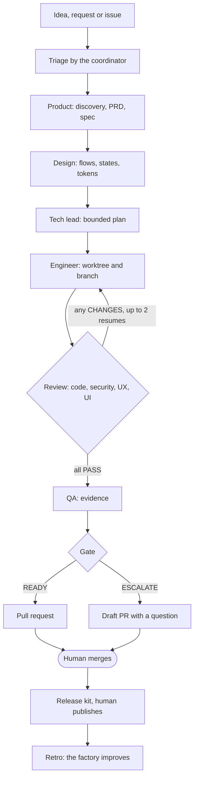

# Product Factory

An agentic product factory. You give it an idea or a request. It produces a
reviewed, tested, documented, launch-ready product increment as a pull
request. **You merge.**



It merges two designs. The first is the Hermes factory (`Mat-Agh/Hermes`): roles,
triage, bounded plans, evidence-based done, human merge, and truth that lives in
the repo. The second is the Claude Code software-factory pattern from the
ZazenCodes video: one orchestrator skill, file-driven subagents, parallel review
lenses, worktree-per-job and machine-readable verdicts. See
[docs/architecture/SOURCES.md](docs/architecture/SOURCES.md) and the
[decision records](docs/decisions/README.md).

## New here?

Read [docs/guide/00-overview.md](docs/guide/00-overview.md), then follow
[docs/guide/01-getting-started.md](docs/guide/01-getting-started.md). It goes
from an empty machine to your first factory PR, with every command and its
expected output. Terms are explained in the
[glossary](docs/guide/GLOSSARY.md). What works today is recorded in
[CURRENT_STATE.md](docs/status/CURRENT_STATE.md).

## Start on any machine or account

A standalone `pf` binary can install the project kit and import stack
handbooks. Download the Linux x86-64 binary and checksum from the
[v1.1.0 release](https://github.com/Mat-Agh/product-factory/releases/tag/v1.1.0).
Put `pf` on `PATH`, then run `pf install project <repo>`.
Build from a Factory checkout with Cargo when you need a binary for a new
platform or want to link your personal Claude Code configuration.

```bash
git clone git@github.com:Mat-Agh/product-factory.git "$HOME/Work/ProductFactory"
cd "$HOME/Work/ProductFactory"
cargo install --path cli         # builds pf, the factory's Rust CLI (needs a Rust toolchain)
pf install user                  # /factory + agents in every project, your operator profile imported
pf install project ~/Work/MyApp --install-graphify
pf doctor ~/Work/MyApp           # verify
```

Then, in Claude Code inside the product repo. In Codex, invoke the same commands with `$product-factory` instead of `/factory`.

```
/factory init                       draft .factory/factory.yaml from the repo
/factory idea <idea>                discovery → PRD → design concept → architecture → roadmap (docs PR)
/factory <request>                  triage and run the right lane to a PR
/factory issue <n|url>              same, from a GitHub/GitLab issue
/factory next                       first unchecked line of .factory/backlog.md
/factory status                     what is running, what needs you
/factory resume <job>               continue a job from its saved stage
/factory rework <job> <note>        send a job back with your feedback
/factory release [version]          readiness brief + launch kit (release PR)
/factory retro [job]                propose factory/AGENTS.md improvements
/factory memory                     promote what Claude remembered into the repo (with approval)
/factory clean                      remove worktrees of merged/closed jobs
```

Run `pf job knowledge <job-id>` to see what committed changes require
documentation and which pages changed.

Run `pf dashboard` and open [the local board](http://127.0.0.1:8000/).
It shows the Markdown backlog, jobs by stage and module, review verdicts,
artifacts and links to PRs. Submit requests through the skill, a GitHub or
GitLab issue, or the backlog.

A single install prepares the project for Claude Code, Codex, Antigravity,
Hermes and Gemini CLI. Claude Code, Codex and Antigravity have generated
native roles. Hermes can coordinate from the same project skill. All hosts
with terminal access can use the Factory worker routes for Claude, GPT,
Gemini or an OpenAI-compatible router such as 9Router. Run
`pf providers setup` to choose models and `pf providers check` for local
requirements. [Runtime setup](docs/guide/01-getting-started.md#model-routing)

Graphify builds a local index when installed. Run `pf graph query "<symbol>"`
to navigate the current checkout, including uncommitted source. Open the
locally generated `.factory/graphify/view.html` for a 3D file network.
For a multi-repository workspace, `pf graph view --modules` writes `.factory/graphify/workspace-view.html` with brain-cloud and thought-sphere layouts.

## What is where

| Path | What |
|---|---|
| [docs/](docs/README.md) | **All documentation**, one connected tree with a generated map. Start at [docs/README.md](docs/README.md) |
| [docs/governance/CONSTITUTION.md](docs/governance/CONSTITUTION.md) | The rules. Everything else applies them |
| [docs/guide/](docs/guide/README.md) | Operator handbook, from zero to the first PR |
| [docs/status/](docs/status/README.md) | Current state, implementation status, roadmap, evolution log |
| [docs/development/](docs/development/README.md) | How to change the factory, including [CONTRIBUTING](docs/development/CONTRIBUTING.md) |
| [kit/](kit/) | Payload installed into a product repo: the `/factory` skill, 10 role agents, the `pf guard` hook wiring, the descriptor template, backlog, dashboard, and the `AGENTS.md` section |
| [cli/](cli/) | `pf`, the factory's single Rust CLI: guard, docs map, diagrams, install, doctor, mirror, export, dashboard ([COMP-015](docs/components/COMP-015-pf-cli.md)) |

## Survives losing this account

Nothing the factory needs lives only in one account. The rules, roles, operator
profile and procedures are in this repo, which can be mirrored to several remotes
and an offline bundle. Each product's descriptor, PRDs, ADRs and backlog are in
the product's own repo. Work in flight is in branches and PRs. See
[docs/guide/05-portability-and-recovery.md](docs/guide/05-portability-and-recovery.md).
