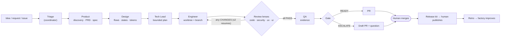

# Product Factory

An agentic product factory. You give it an idea or a request. It produces a
reviewed, tested, documented, launch-ready product increment as a pull
request. **You merge.**



It merges two designs. The first is the Hermes factory (`Mat-Agh/Hermes`): roles,
triage, bounded plans, evidence-based done, human merge, and truth that lives in
the repo. The second is the Claude Code software-factory pattern from the
ZazenCodes video: one orchestrator skill, file-driven subagents, parallel review
lenses, worktree-per-job and machine-readable verdicts. See
[docs/architecture/SOURCES.md](docs/architecture/SOURCES.md) and the
[decision records](docs/decisions/README.md).

## New here?

Read [docs/guide/00-overview.md](docs/guide/00-overview.md), then follow
[docs/guide/01-getting-started.md](docs/guide/01-getting-started.md). It goes
from an empty machine to your first factory PR, with every command and its
expected output. Terms are explained in the
[glossary](docs/guide/GLOSSARY.md). What works today is recorded in
[CURRENT_STATE.md](CURRENT_STATE.md).

## Start on any machine or account

```bash
git clone git@github.com:Mat-Agh/product-factory.git "$HOME/Work/ProductFactory"
cd "$HOME/Work/ProductFactory"
scripts/install.sh user                  # /factory + agents in every project, your operator profile imported
scripts/install.sh project ~/Work/MyApp  # put the kit inside a product repo (commit it there)
scripts/doctor.sh ~/Work/MyApp           # verify
```

Then, in Claude Code inside the product repo:

```
/factory init                       draft .factory/factory.yaml from the repo
/factory idea <idea>                discovery → PRD → design concept → architecture → roadmap (docs PR)
/factory <request>                  triage and run the right lane to a PR
/factory issue <n|url>              same, from a GitHub/GitLab issue
/factory next                       first unchecked line of .factory/backlog.md
/factory status                     what is running, what needs you
/factory rework <job> <note>        send a job back with your feedback
/factory release [version]          readiness brief + launch kit (release PR)
/factory retro [job]                propose factory/AGENTS.md improvements
/factory clean                      remove worktrees of merged/closed jobs
```

The dashboard is `cd .factory && python3 -m http.server`, then open
<http://localhost:8000/dashboard.html>.

Codex, Cursor, Gemini or Hermes can run the same roles. See
[adapters/](adapters/).

## What is where

| Path | What |
|---|---|
| [CONSTITUTION.md](CONSTITUTION.md) | The rules. Everything else applies them. |
| [kit/](kit/) | What gets installed into a product repo: the `/factory` skill, the 10 role agents, the guard hook, the descriptor template, backlog, dashboard, and the `AGENTS.md` section. |
| [operator/USER.md](operator/USER.md) | Who you are and how you want agents to work. Lives in git, not in any vendor's memory. |
| [adapters/](adapters/) | How Hermes, Codex, Cursor and others run the same roles. |
| [scripts/](scripts/) | `install.sh`, `doctor.sh`, `mirror.sh` (backup remotes and offline bundles), `export-claude.sh`, `check-docs.py`. |
| [tests/](tests/) | Guard hook tests (`python3 tests/guard_test.py`). |
| [docs/](docs/README.md) | Operator guide, architecture, component contracts and status, development handbook, ADRs, roadmap, evolution log. |
| [CURRENT_STATE.md](CURRENT_STATE.md) · [CONTRIBUTING.md](CONTRIBUTING.md) | What exists and is verified now · how to change the factory |

## Survives losing this account

Nothing the factory needs lives only in one account. The rules, roles, operator
profile and procedures are in this repo, which can be mirrored to several remotes
and an offline bundle. Each product's descriptor, PRDs, ADRs and backlog are in
the product's own repo. Work in flight is in branches and PRs. See
[docs/guide/05-portability-and-recovery.md](docs/guide/05-portability-and-recovery.md).
