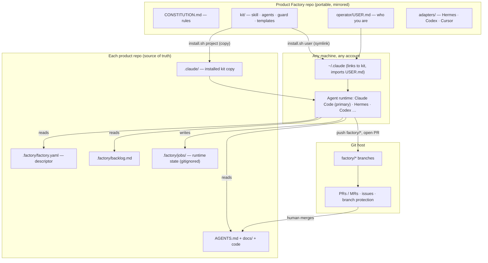
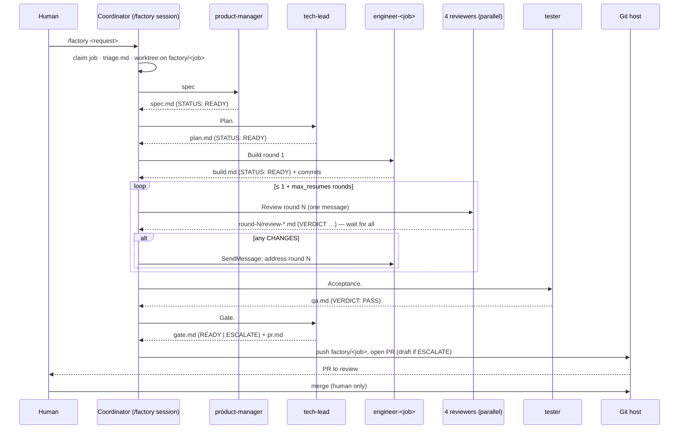

# Factory overview

**Status:** Active
**Last updated:** 2026-10-19

## Layers

| Layer | Holds | Lifetime | Lost if… |
|---|---|---|---|
| Factory repo | rules, roles, procedures, operator profile | permanent, versioned | every mirror and bundle is gone |
| Product repo | product truth: PRDs, ADRs, contracts, code, descriptor, backlog | permanent, versioned | the product's remotes are gone |
| Git host | work in flight (branches, PRs), intake (issues), protection | per job | the host account is gone, but branches can be re-pushed from any clone |
| Job folder | per-job scratch: triage, spec, plan, reviews, QA, gate | until `/factory clean` | the machine is lost, which is acceptable because the PR body carries the summary and the durable docs are in the branch |
| Agent runtime | nothing durable | per session | the account is lost, which costs nothing because no durable state lives there |

## Runtime: one job

## Contracts between components

- **Descriptor** (`.factory/factory.yaml`) says *where* things are and *what the
  policy is*: modules, VCS, docs paths, surfaces, risk paths, limits. It contains
  no conventions or commands. Those stay in `AGENTS.md`.
- **AGENTS.md** says *how*: setup, dev server, gates, conventions, docs map.
  Every agent reads it live, and the factory never copies it.
- **Artifacts** each have exactly one writer, and their first line is a verdict
  (table in `kit/.claude/skills/factory/SKILL.md`). The coordinator acts only on
  verdicts. A missing or malformed verdict stops the job.
- **job.json** has one writer, the coordinator. The dashboard and
  `/factory status` read it.

## Roles and models

| Role | Model | Writes | Never |
|---|---|---|---|
| coordinator (the `/factory` session) | session model (use Opus) | `triage.md`, `job.json`, exhausted-rounds `gate.md` | specs, plans, code, reviews |
| product-manager | opus | `discovery.md`, `spec.md`, PRD in branch | runtime code |
| designer | opus | `design.md`, design docs in branch | invented product behaviour, invented pixels |
| tech-lead | opus | `plan.md`, ADR in branch, `gate.md`, `pr.md` | implementation, merge |
| engineer | sonnet | code + docs commits, `build.md` | widening scope, pushing |
| reviewer-code | sonnet | `review-code.md` | fixing |
| reviewer-security | opus | `review-security.md` | fixing |
| reviewer-ux / reviewer-ui | sonnet | `review-ux.md` / `review-ui.md` | fixing |
| tester | sonnet | `repro.md`, `qa.md` | fixing, self sign-off |
| release-manager | opus | `release.md`, release files in branch | tagging, publishing, sending |

These follow Hermes' role classes. Thinking and gating roles use the deep model,
and execution roles use the build model. Security is deep because its misses
are the most expensive. To change a model, edit the agent's frontmatter in
`kit/` and re-install. A reviewer from a different model family (for example a
Codex review lens) is on the roadmap.

## Enforcement

| Rule | Prose | Mechanical |
|---|---|---|
| Humans merge, tag, release | CONSTITUTION §5, every role | guard hook blocks `git merge`, `gh pr merge`, `glab mr merge`, tags, releases; **branch protection** on the remote |
| Factory pushes only `factory/*` | SKILL.md | guard hook rejects any other push target and any force-push |
| No skipped hooks, no discarded work | CONSTITUTION §6 | guard blocks `--no-verify`, `reset --hard`, `clean -f`, `stash`, `checkout -- .` |
| Bounded rework | SKILL.md `max_resumes` | coordinator counter in `job.json` |
| One writer per file | protocol.md | review: reviewers have no Edit tool; the coordinator checks expected files exist |
| Done = evidence | engineer, tester, gate | the gate refuses READY without evidence in `build.md` and `qa.md` |

The guard is a second line of defence, not a sandbox. A determined process with a
shell can still write files. Branch protection on the base branch is the control
that holds, and `doctor.sh` checks for it.

<!-- documentation-routing:start -->
## Documentation routing

- [Parent README](README.md)
- [Governing agent guide](../../AGENTS.md)
<!-- documentation-routing:end -->
