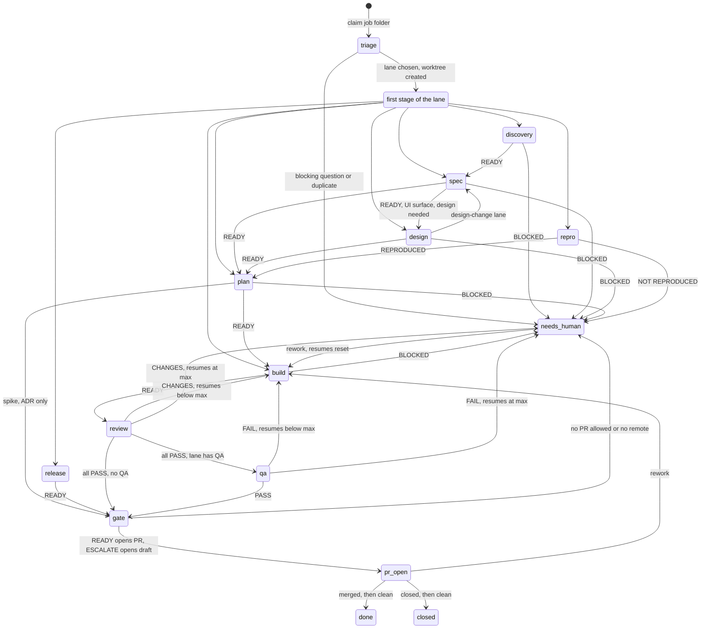

# Job lifecycle

**Status:** Active
**Last updated:** 2026-10-19

The shared coordinator procedure is
[`SKILL.md`](../../kit/.claude/skills/factory/SKILL.md).
[`pf job`](../../cli/src/job.rs) owns job claims, lane selection, local Git
preparation and evidence transitions.

## State machine

`job.json.stage` is the state. The coordinator invokes `pf job advance` with
the expected stage and round. The CLI reads the exact verdicts, checks the
worktree commit and atomically persists the result.

## Guards

| Guard | Enforced by |
|---|---|
| A stage starts only after the previous artifact exists and its first line is a valid verdict | `pf job advance`. Missing or invalid evidence leaves the stage unchanged |
| A review round finishes only when every required lens file exists | `pf job advance` waits for valid verdicts from all required lenses on the pinned commit |
| `resumes ≤ limits.max_resumes` (default 2) | `job.json.resumes` counter, shared by review and QA failures |
| Concurrency ≤ `limits.max_parallel_jobs` | workspace file lock and active-job count |
| Job ids are unique | workspace lock and monotonic numbering |
| Backlog lines are claimed once | workspace lock. The claimed line records its job ID |
| PRs never merge automatically | guard hook plus branch protection. The gate's best outcome is "PR open" |

## Lanes

The route is enforced by `pf job prepare`. A pause can occur during setup or a stage. Human rework returns to the role that owns the blocked artifact.

| Type | trivial | standard | cross-cutting |
|---|---|---|---|
| feature | triage → build → review(code, security*) → gate | triage → spec → design† → plan → build → review → qa → gate | as standard + ADR + all lenses, gate always ESCALATE |
| bug | as standard (a bug is always reproduced first) | triage → repro → plan → build → review → qa → gate | as standard, always ESCALATE |
| design | — | triage → design → spec → plan → build → review → qa → gate | as standard, always ESCALATE |
| docs | triage → build → review(code) → gate | triage → spec → build → review(code) → gate | as standard, always ESCALATE |
| chore | triage → build → review(code, security) → gate | triage → plan → build → review(code, security) → gate | as standard, always ESCALATE |
| spike | — | triage → plan (investigation + ADR) → gate | same |
| idea | — | triage → discovery → spec (PRD) → design (concept) → plan (ADR + roadmap) → gate | same |
| release | — | triage → release → gate | same |

\* security runs on trivial work when code paths change. † design runs only when
the surface is `ui` and the spec says the design source is missing or must
change. The review lenses are code and security for any code change, plus UX and
UI when the surface is `ui`.

## Artifact contract

| Artifact | Writer | First line | Read by |
|---|---|---|---|
| `job.json` | `pf job` | (JSON) | coordinator, dashboard, `/factory status` |
| `triage.md` | coordinator | `# Triage:` (no verdict; triage outcome is in `job.json`) | every agent |
| `discovery.md` | product-manager | `STATUS: READY \| BLOCKED` | product-manager (spec), designer, tech-lead |
| `spec.md` | product-manager | `STATUS: READY \| BLOCKED` | everyone downstream |
| `repro.md` | tester | `REPRODUCED \| NOT REPRODUCED` | tech-lead, engineer, tester (QA) |
| `design.md` | designer | `STATUS: READY \| BLOCKED` | tech-lead, engineer, reviewer-ux/ui |
| `plan.md` | tech-lead | `STATUS: READY \| BLOCKED` | engineer, reviewers, tester, gate |
| `build.md` | engineer | `STATUS: READY \| BLOCKED` | reviewers, tester, gate |
| `round-N/review-<lens>.md` | reviewer-<lens> | `VERDICT: PASS \| CHANGES` | coordinator, engineer, gate, the same lens in round N+1 |
| `qa.md` | tester | `VERDICT: PASS \| FAIL` | coordinator, engineer, gate |
| `gate.md` | tech-lead (or coordinator when rounds run out) | `READY \| ESCALATE` | coordinator, human |
| `pr.md` | tech-lead | (PR body) | coordinator → git host |
| `release.md` | release-manager | `STATUS: READY \| BLOCKED` | gate, human |
| `rework-<k>.md` | coordinator (your note, verbatim) | (free text) | engineer |
| `retro.md` | coordinator | (free text) | human, factory PR |

Changing any first-line format is a **breaking change** to the factory. See
[development/03-changing-the-factory.md](../development/03-changing-the-factory.md).

## Isolation per job

| Resource | Scheme |
|---|---|
| Branch | `vcs.branch_template` (default `factory/<job-id>`; `{kind}/{job-id}` for GitFlow repos) |
| Worktree | root module: `../<name>-factory/<job-id>/`; module: `../<name>-factory/<area>/<job-id>/`, outside the workspace. A module in a shared Git history uses the owning repository worktree plus the module subpath |
| Ports | `surfaces.ui.port_base + 10·n + k`, with k = 0 engineer, 1 ux, 2 ui, 3 tester, and n = the job number |
| Browser sessions | `<job-id>-<role>` |
| Engineer identity | named `engineer-<job-id>` so the coordinator can resume it with `SendMessage` |

<!-- documentation-routing:start -->
## Documentation routing

- Parent: [Architecture](README.md)
- Documentation home: [Product Factory documentation](../README.md)
- Agent guide: [AGENTS.md](../../AGENTS.md)
<!-- documentation-routing:end -->
