# Job lifecycle

**Status:** Active
**Last updated:** 2026-10-19

The executable procedure is
[`SKILL.md`](../../kit/.claude/skills/factory/SKILL.md). This page explains
its model: states, transitions, guards and the contracts that make the
procedure deterministic.

## State machine

`job.json.stage` is the state. Only the coordinator changes it, and it does so
only after reading an artifact's verdict.

Diagram source: [`job-state-machine.mmd`](../assets/diagrams/job-state-machine.mmd) · re-render with `pf diagrams render`

## Guards

| Guard | Enforced by |
|---|---|
| A stage starts only after the previous artifact exists and its first line is a valid verdict | coordinator. Anything else stops the job |
| A review round finishes only when every required lens file exists | coordinator ("wait for all"). The engineer is never resumed mid-round |
| `resumes ≤ limits.max_resumes` (default 2) | `job.json.resumes` counter, shared by review and QA failures |
| Concurrency ≤ `limits.max_parallel_jobs` | the coordinator counts active jobs before claiming |
| Job ids are unique | `mkdir` without `-p` is atomic. On failure, take the next number |
| Backlog lines are claimed once | one exact-line Edit (`- [ ]` → `- [x] … → claimed`). On failure, take the next line |
| PRs never merge automatically | guard hook plus branch protection. The gate's best outcome is "PR open" |

## Lanes

| Type | trivial | standard | cross-cutting |
|---|---|---|---|
| feature | triage → build → review(code, security*) → gate | triage → spec → design† → plan → build → review → qa → gate | as standard + ADR + all lenses, gate always ESCALATE |
| bug | as standard (a bug is always reproduced first) | triage → repro → plan → build → review → qa → gate | as standard, always ESCALATE |
| design | — | triage → design → spec → plan → build → review → qa → gate | as standard, always ESCALATE |
| docs | triage → build → review(code) → gate | triage → spec → build → review(code) → gate | as standard, always ESCALATE |
| chore | triage → build → review(code, security) → gate | triage → plan → build → review(code, security) → gate | as standard, always ESCALATE |
| spike | — | triage → plan (investigation + ADR) → gate | same |
| idea | — | triage → discovery → spec (PRD) → design (concept) → plan (ADR + roadmap) → gate | same |
| release | — | triage → release → gate | same |

\* security runs on trivial work when code paths change. † design runs only when
the surface is `ui` and the spec says the design source is missing or must
change. The review lenses are code and security for any code change, plus UX and
UI when the surface is `ui`.

## Artifact contract

| Artifact | Writer | First line | Read by |
|---|---|---|---|
| `job.json` | coordinator | (JSON) | coordinator, dashboard, `/factory status` |
| `triage.md` | coordinator | `# Triage:` (no verdict; triage outcome is in `job.json`) | every agent |
| `discovery.md` | product-manager | `STATUS: READY \| BLOCKED` | product-manager (spec), designer, tech-lead |
| `spec.md` | product-manager | `STATUS: READY \| BLOCKED` | everyone downstream |
| `repro.md` | tester | `REPRODUCED \| NOT REPRODUCED` | tech-lead, engineer, tester (QA) |
| `design.md` | designer | `STATUS: READY \| BLOCKED` | tech-lead, engineer, reviewer-ux/ui |
| `plan.md` | tech-lead | `STATUS: READY \| BLOCKED` | engineer, reviewers, tester, gate |
| `build.md` | engineer | `STATUS: READY \| BLOCKED` | reviewers, tester, gate |
| `round-N/review-<lens>.md` | reviewer-<lens> | `VERDICT: PASS \| CHANGES` | coordinator, engineer, gate, the same lens in round N+1 |
| `qa.md` | tester | `VERDICT: PASS \| FAIL` | coordinator, engineer, gate |
| `gate.md` | tech-lead (or coordinator when rounds run out) | `READY \| ESCALATE` | coordinator, human |
| `pr.md` | tech-lead | (PR body) | coordinator → git host |
| `release.md` | release-manager | `STATUS: READY \| BLOCKED` | gate, human |
| `rework-<k>.md` | coordinator (your note, verbatim) | (free text) | engineer |
| `retro.md` | coordinator | (free text) | human, factory PR |

Changing any first-line format is a **breaking change** to the factory. See
[development/03-changing-the-factory.md](../development/03-changing-the-factory.md).

## Isolation per job

| Resource | Scheme |
|---|---|
| Branch | `factory/<job-id>` (`vcs.branch_prefix`) |
| Worktree | `<repo>/../<repo-name>-factory/<job-id>/` (multi-repo: next to the module clone) |
| Ports | `surfaces.ui.port_base + 10·n + k`, with k = 0 engineer, 1 ux, 2 ui, 3 tester, and n = the job number |
| Browser sessions | `<job-id>-<role>` |
| Engineer identity | named `engineer-<job-id>` so the coordinator can resume it with `SendMessage` |

<!-- documentation-routing:start -->
## Documentation routing

- Parent: [Architecture](README.md)
- Documentation home: [Product Factory documentation](../README.md)
- Agent guide: [AGENTS.md](../../AGENTS.md)
<!-- documentation-routing:end -->
