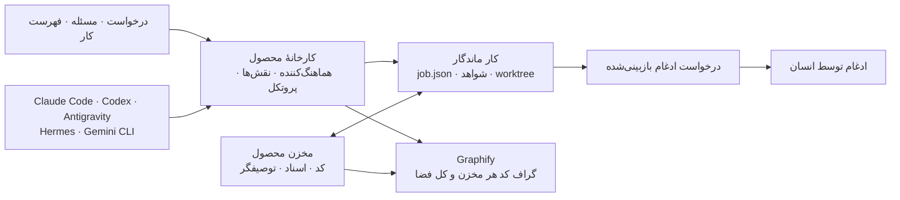

# اطلس کارخانهٔ محصول

**Status:** Active — نقشهٔ مستند واقعیت‌های تأییدشده

| وضعیت در | انتشار | قاعدهٔ نگهداری |
|---|---|---|
| ۲۰۲۶-۱۱-۱۶ | [نسخهٔ تولیدی امضاشدهٔ v1](https://github.com/Mat-Agh/product-factory/releases/tag/v1)، ابزار `pf` نسخهٔ 1.3.5 | هر تغییر در قرارداد یا وضعیت تأییدشده |

**English:** [Product Factory Atlas](ATLAS.md) · **نمای دیداری:** [اطلس در مرورگر](ATLAS.html)

این نقشه دربارهٔ **خود کارخانه** است. واقعیت‌های پیاده‌سازی‌شده و آزموده را به
سند مالک آن‌ها وصل می‌کند. مدل کسب‌وکار محصولات را توصیف نمی‌کند و جای اطلس،
کد، مسائل یا اسناد هر محصول را نمی‌گیرد. کارهای باز در [نقشهٔ راه](../status/ROADMAP.md)
و شواهد دقیق در [وضعیت پیاده‌سازی](../status/IMPLEMENTATION_STATUS.md) هستند.

## در یک نگاه

| واقعیت | منبع |
|---|---|
| کارخانهٔ محصول یک چارچوب توسعهٔ قابل نصب است که درخواست را به درخواست ادغامِ بازبینی‌شده، آزموده و مستند می‌رساند. ادغام با انسان است. | [معرفی](../guide/00-overview.md) · [قانون اساسی](../governance/CONSTITUTION.md) |
| ابزار Rust به نام `pf` نصب کیت، وضعیت کار، محافظ‌ها، نقشهٔ اسناد، گراف کد، داشبورد و ابزارهای جابه‌جایی را اداره می‌کند. | [قرارداد CLI](../components/COMP-015-pf-cli.md) |
| یک کیت از مخزن مستقل، مخزن چندفناوری و فضای کار چندمخزنی پشتیبانی می‌کند. تنظیمات اختصاصی در توصیفگر محصول و `AGENTS.md` آن است. | [نصب‌کننده](../components/COMP-007-installer.md) · [راهنمای چندمخزنی](../guide/07-multi-repo-workspaces.md) |
| تعریف ده نقش فقط در یک محل نگهداری می‌شود. هماهنگ‌کننده و پروتکل، گردش کار و قواعد مشترک را تعیین می‌کنند. | [نقش‌ها](../../kit/.claude/agents/) · [هماهنگ‌کننده](../../kit/.claude/skills/factory/SKILL.md) · [پروتکل](../../kit/.claude/skills/factory/protocol.md) |
| Claude Code، Codex و Antigravity نقش‌های بومی می‌گیرند؛ Hermes و Gemini CLI از مهارت مشترک پروژه استفاده می‌کنند. قرارداد کارخانه در همهٔ میزبان‌ها یکسان می‌ماند. | [سازگارکننده‌ها](../adapters/README.md) · [یکپارچه‌سازی نشست](../components/COMP-016-session-integration.md) |
| ابزار امضاشدهٔ `v1` روی Connect نصب شده و بورد و شبکهٔ کد محلی فعال‌اند. اجرای کامل یک کار واقعی تا تحویل PR میزبانی‌شده هنوز تأیید نشده است. | [وضعیت فعلی](../status/CURRENT_STATE.md) · [وضعیت پیاده‌سازی](../status/IMPLEMENTATION_STATUS.md) |

## تصویر سامانه

[قانون اساسی](../governance/CONSTITUTION.md) بر کل کارخانه حاکم است.
[توصیفگر پروژه](../components/COMP-005-project-descriptor.md) و `AGENTS.md` محصول،
دستورها، کنترل‌ها و مرزهای اختصاصی همان محصول را می‌دهند.

## مسیر انجام کار

| گام | خروجی و مرجع |
|---|---|
| دریافت و دسته‌بندی | شرح مستقیم، مسئله یا مورد فهرست کار به کاری با محدوده و مسئول مشخص تبدیل می‌شود ([بورد](../components/COMP-006-backlog-and-dashboard.md)، [چرخهٔ کار](../architecture/JOB_LIFECYCLE.md)). |
| شناخت و برنامه | بررسی، مشخصات، طراحی در صورت نیاز و برنامهٔ محدود، در پرونده‌های کار ثبت می‌شوند ([قرارداد آثار](../architecture/JOB_LIFECYCLE.md#artifact-contract)). |
| ساخت | مهندس در شاخه و worktree جدا کار می‌کند؛ کد و اسناد محصول در مخزن خود می‌مانند ([چرخهٔ کار](../architecture/JOB_LIFECYCLE.md)، [ساختار دانش](../components/COMP-018-knowledge-structure.md)). |
| بازبینی و کیفیت | دیدگاه‌های لازم نتیجهٔ قابل‌خواندن برای ماشین ثبت می‌کنند؛ شکست به بازکاری محدود برمی‌گردد و QA شواهد پذیرش را ثبت می‌کند ([چرخهٔ کار](../architecture/JOB_LIFECYCLE.md)). |
| دروازه و تحویل | پس از آمادگی، PR ساخته می‌شود. پرسش‌ها ارجاع داده می‌شوند؛ محافظ از ادغام و انتشار مستقیم و دورزدن کنترل‌ها جلوگیری می‌کند. تصمیم ادغام با انسان است ([محافظ](../components/COMP-004-guard-hook.md)، [ADR-002](../decisions/ADR-002-human-only-merge.md)). |

جزئیات نقش‌ها و انتقال‌ها فقط در [مهارت هماهنگ‌کننده](../../kit/.claude/skills/factory/SKILL.md)،
[پروتکل](../../kit/.claude/skills/factory/protocol.md) و [پرونده‌های نقش](../../kit/.claude/agents/) نگهداری می‌شوند.

## اطلاعات کجا نگهداری می‌شوند

| محل | اطلاعات ماندگار |
|---|---|
| مخزن Git کارخانه | قانون اساسی، کیت، نقش‌ها، دانش عمومی فناوری، CLI، راهنمای بهره‌بردار و همین اطلس ([ساختار مخزن](../development/02-repository-layout.md)). |
| مخزن Git محصول | `AGENTS.md`، توصیفگر، کد، اسناد، فهرست کار، شاخه‌های PR و تصمیم‌های پذیرفته‌شده ([توصیفگر](../components/COMP-005-project-descriptor.md)). |
| پوشهٔ `.factory/jobs/` محصول | وضعیت و شواهد محلی کار که در Git ثبت نمی‌شوند؛ شاخه و PR تغییرات محصول را حمل می‌کنند ([خواندن یک کار](../guide/03-reading-a-job.md)). |
| حافظهٔ Graphify | نمایهٔ محلی و قابل بازسازی نمادها و روابط کد و نمای تعاملی؛ فایل‌های منبع مرجع نهایی‌اند ([راهنمای گراف](../guide/04-add-a-project.md)). |
| Hermes و 9Router | میزبان، مسیریابی مدل و زمینهٔ مشترک اختیاری برای یک نصب؛ مرجع حقیقت محصول نیستند ([سازگارکنندهٔ Hermes](../adapters/hermes.md)). |

## نماهای بهره‌بردار

| نما | کاربرد |
|---|---|
| [داشبورد محصول](../components/COMP-006-backlog-and-dashboard.md) | کارها، مسائل، شرح‌ها، شواهد بازبینی، PRها، دریافت کار و وضعیت سامانه. در محصول نصب‌شده با `pf dashboard` اجرا می‌شود. |
| [شبکهٔ کد](../guide/04-add-a-project.md) | جست‌وجوی نمادها و بررسی فایل‌ها و روابط جهت‌دار. `pf graph watch --modules` مخزن‌های مستقل و نمای ترکیبی را تازه می‌کند. بوم حداکثر ۴۰۰ فایل را هم‌زمان رسم می‌کند. |
| [اطلس محصول](../../kit/.factory/atlas.html) | راهنمای نماهای داشبورد در محصول نصب‌شده؛ `atlas.json` متعلق به همان پروژه است. این صفحه اطلس خود کارخانه است. |
| [وضعیت و نقشهٔ راه](../status/README.md) | پیاده‌سازی تأییدشده و معیارهای پذیرش باقی‌مانده. |

## وضعیت تحویل و محدودیت‌ها

- CLI امضاشدهٔ `v1` نسخهٔ 1.3.5، ۳۹ آزمون Rust، Clippy، قالب‌بندی، خودآزمایی محافظ، بررسی نمودار، نقشهٔ اسناد و doctor را گذرانده است ([وضعیت پیاده‌سازی](../status/IMPLEMENTATION_STATUS.md)).
- Connect کیت کنونی، داشبورد محلی و پایشگر گراف را دارد. این شاهد نصب است، نه اثبات اجرای کامل یک کار واقعی تا PR میزبانی‌شده ([وضعیت فعلی](../status/CURRENT_STATE.md)).
- Graphify نحوهای پشتیبانی‌شده را نمایه می‌کند و در بررسی اخیر، هر فایل منبع رهگیری‌شدهٔ Connect در گراف فضای کار نماینده داشت. وجود گره برای تک‌تک تابع‌ها، کلاس‌ها، متغیرها یا خط‌های کد تضمین نشده است؛ کد منبع مرجع است ([راهنمای گراف](../guide/04-add-a-project.md)).
- [نقشهٔ راه](../status/ROADMAP.md) معیارهای باز فاز ۱، از جمله تحویل کار واقعی و مخزن پشتیبان دوم، را نگه می‌دارد. اطلس پس از گذر واقعی این کنترل‌ها به‌روزرسانی می‌شود.

## شروع استفاده

برای گام‌های عملی بهره‌بردار، [راهنمای استفادهٔ روزمره](../guide/09-day-to-day-usage.fa.md)
([English](../guide/09-day-to-day-usage.md)) را ببینید.

1. کیت را در محصول [نصب یا به‌روز کنید](../guide/01-getting-started.md).
2. به میزبان عامل یک [درخواست محدود بدهید](../guide/02-commands.md)، یا موردی از بورد/مسائل بردارید.
3. [وضعیت کار](../guide/03-reading-a-job.md) و شواهد آن را در داشبورد ببینید.
4. PR را بررسی و خودتان ادغام کنید؛ سپس در صورت نیاز مسیر انتشار و بازنگری را اجرا کنید ([دستورها](../guide/02-commands.md)).

<!-- documentation-routing:start -->
## Documentation routing

- Parent: [Product Factory Atlas](README.md)
- Documentation home: [Product Factory documentation](../README.md)
- Agent guide: [AGENTS.md](../../AGENTS.md)
<!-- documentation-routing:end -->
