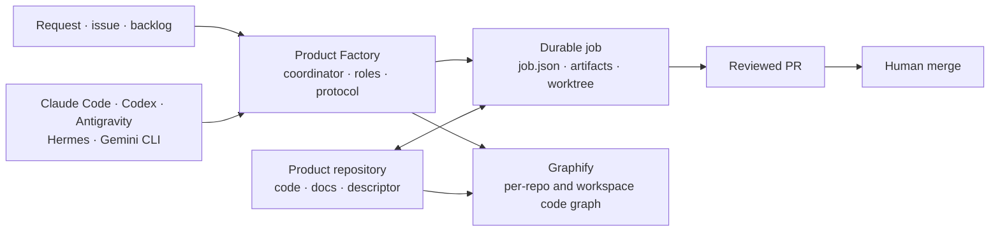

# Product Factory Atlas

**Status:** Active — sourced map of verified facts

| As of | Release | Updated by |
|---|---|---|
| 2026-11-16 | [Signed production v1](https://github.com/Mat-Agh/product-factory/releases/tag/v1), CLI 1.3.5 | Every change to a decided boundary or verified state |

**فارسی:** [اطلس کارخانهٔ محصول](ATLAS.fa.md) — the same map in Persian.
**Visual:** [Open the browser Atlas](ATLAS.html).

This is the one-page map of the **factory itself**. It records implemented
contracts and verified behavior. It does not describe any product's business
model or replace that product's own Atlas, source code, issues, or docs.
Open work and future phases live in the [roadmap](../status/ROADMAP.md); the
[implementation status](../status/IMPLEMENTATION_STATUS.md) carries detailed
evidence and remaining checks.

## At a glance

| Fact | Source |
|---|---|
| Product Factory is a portable development harness that moves a request to a reviewed, tested, documented pull request. A human merges. | [Overview](../guide/00-overview.md) · [Constitution](../governance/CONSTITUTION.md) |
| The `pf` Rust CLI installs the kit, manages job state, guard checks, documentation maps, code graphs, dashboard serving, and portability tools. | [CLI contract](../components/COMP-015-pf-cli.md) |
| One kit supports standalone repositories, mixed-stack repositories, and workspaces of independent repositories. Product-specific settings live in the product descriptor and `AGENTS.md`. | [Installer](../components/COMP-007-installer.md) · [Workspace guide](../guide/07-multi-repo-workspaces.md) |
| The ten role definitions have one source; the coordinator and protocol own the workflow and shared rules. | [Role files](../../kit/.claude/agents/) · [Coordinator](../../kit/.claude/skills/factory/SKILL.md) · [Protocol](../../kit/.claude/skills/factory/protocol.md) |
| Claude Code, Codex and Antigravity receive native roles; Hermes and Gemini CLI use the shared project skill. The factory contract stays the same across hosts. | [Runtime adapters](../adapters/README.md) · [Session integration](../components/COMP-016-session-integration.md) |
| The signed `v1` binary is installed on Connect. Its local board and code network are live. A complete real-product job through a hosted PR remains unverified. | [Current state](../status/CURRENT_STATE.md) · [Implementation status](../status/IMPLEMENTATION_STATUS.md) |

## The system in one picture

The [Constitution](../governance/CONSTITUTION.md) governs every part of the
factory. The [project descriptor](../components/COMP-005-project-descriptor.md)
and product `AGENTS.md` supply the product's own commands, gates and boundaries.

## How work moves

| Step | Result and authority |
|---|---|
| Intake and triage | A direct brief, issue or backlog item becomes a serialized job with a bounded lane and owner ([backlog](../components/COMP-006-backlog-and-dashboard.md), [job lifecycle](../architecture/JOB_LIFECYCLE.md)). |
| Product and plan | Discovery, specification, design when needed, and a bounded implementation plan are saved as job artifacts ([artifact contract](../architecture/JOB_LIFECYCLE.md#artifact-contract)). |
| Build | The engineer changes an isolated branch and worktree; product code and docs stay in their repository ([job lifecycle](../architecture/JOB_LIFECYCLE.md), [knowledge structure](../components/COMP-018-knowledge-structure.md)). |
| Review and QA | Required review lenses record machine-readable verdicts. Failed reviews return to bounded rework; QA records acceptance evidence ([job lifecycle](../architecture/JOB_LIFECYCLE.md)). |
| Gate and delivery | A ready gate leads to a PR; questions escalate. The guard blocks direct merge, tag, release and unsafe bypass commands; the human decides the merge ([guard](../components/COMP-004-guard-hook.md), [ADR-002](../decisions/ADR-002-human-only-merge.md)). |

The role instructions and exact transition procedure live only in the
[coordinator skill](../../kit/.claude/skills/factory/SKILL.md),
[protocol](../../kit/.claude/skills/factory/protocol.md), and
[role files](../../kit/.claude/agents/).

## What is kept where

| Place | Durable information |
|---|---|
| Factory Git repository | Constitution, installable kit, role definitions, generic stack knowledge, CLI, operator guidance and this Atlas ([repository layout](../development/02-repository-layout.md)). |
| Product Git repository | Product `AGENTS.md`, descriptor, code, product docs, backlog, PR branches and accepted decisions ([descriptor](../components/COMP-005-project-descriptor.md)). |
| Product `.factory/jobs/` | Local job state and evidence; ignored by Git. The branch and PR carry the product changes ([reading a job](../guide/03-reading-a-job.md)). |
| Graphify cache | Refreshable, local index of extracted source symbols and relationships, plus an interactive view. Source files remain authoritative ([graph guide](../guide/04-add-a-project.md)). |
| Hermes/9Router | Optional host, model routing and shared context for a deployment; they do not own product truth ([Hermes adapter](../adapters/hermes.md)). |

## Operator surfaces

| Surface | Use |
|---|---|
| [Product dashboard](../components/COMP-006-backlog-and-dashboard.md) | Live jobs, source issues, descriptions, review evidence, PRs, intake and systems. An installed product serves it with `pf dashboard`. |
| [Code network](../guide/04-add-a-project.md) | Search all indexed symbols, inspect files and directed relationships. `pf graph watch --modules` refreshes independent repositories and the combined view. The canvas draws at most 400 files at once. |
| [Product Atlas](../../kit/.factory/atlas.html) | The installed product's dashboard directory and explanation. Its `atlas.json` is project-owned; this page is the Atlas of the factory itself. |
| [Status and roadmap](../status/README.md) | Verified implementation and unfinished acceptance work. |

## Delivery state and limits

- The signed `v1` CLI 1.3.5 passes 39 Rust tests, Clippy, formatting, guard
  self-test, diagram check, documentation map and doctor
  ([implementation status](../status/IMPLEMENTATION_STATUS.md)).
- Connect is installed with the current kit and the local dashboard and graph
  watcher. This is installation evidence, not proof of a complete real-product
  job through hosted PR delivery ([current state](../status/CURRENT_STATE.md)).
- Graphify indexes supported syntax and every tracked Connect source file was
  represented in the checked workspace graph. A graph node for every function,
  class, variable or line is **not** guaranteed; source code is authoritative
  ([graph guide](../guide/04-add-a-project.md)).
- The [roadmap](../status/ROADMAP.md) keeps the open Phase 1 acceptance criteria,
  including real job delivery and a second backup remote. The Atlas is updated
  when those checks actually pass.

## Start using it

For the practical operator sequence, use the [day-to-day guide](../guide/09-day-to-day-usage.md)
([فارسی](../guide/09-day-to-day-usage.fa.md)).

1. [Install or update](../guide/01-getting-started.md) the kit in a product.
2. [Describe a bounded request](../guide/02-commands.md) to an installed agent
   host, or claim a backlog/issue item.
3. [Read the job](../guide/03-reading-a-job.md) and its live dashboard evidence.
4. Review the PR, merge it yourself, then run the release and retro lanes as
   appropriate ([commands](../guide/02-commands.md)).

<!-- documentation-routing:start -->
## Documentation routing

- Parent: [Product Factory Atlas](README.md)
- Documentation home: [Product Factory documentation](../README.md)
- Agent guide: [AGENTS.md](../../AGENTS.md)
<!-- documentation-routing:end -->
