# 16 — Documentation link map

**Status:** Active — agent routing authority
**Last updated:** 2026-10-19

Use this map to route to the smallest useful set of documents. Read every
document only for repo-wide documentation work. The exhaustive list is
[documentation map](../README.md#documentation-map).

Diagram source: [`doc-routing.mmd`](../assets/diagrams/doc-routing.mmd) · re-render with `pf diagrams render`

## Knowledge order

1. `AGENTS.md`, this map, and `docs/README.md`
2. The source file that defines the concept (table below)
3. The routed docs for the task
4. Hermes (`Mat-Agh/Hermes` docs) only for history or the Hermes adapter
5. Official Claude Code documentation for platform behaviour (skills,
   subagents, hooks)

## Router

| Task | Read first | Then if needed |
|---|---|---|
| Any change | `AGENTS.md`, [03-changing-the-factory](03-changing-the-factory.md) | [00-principles](00-factory-engineering-principles.md) |
| Rules / authority | `CONSTITUTION.md` | [COMP-013](../components/COMP-013-constitution.md), [ADR-002](../decisions/ADR-002-human-only-merge.md) |
| Coordinator, commands, lanes | `kit/.claude/skills/factory/SKILL.md` | [COMP-001](../components/COMP-001-coordinator-skill.md), [JOB_LIFECYCLE](../architecture/JOB_LIFECYCLE.md), [guide/02](../guide/02-commands.md) |
| Agent behaviour | `kit/.claude/agents/<role>.md`, `kit/.claude/skills/factory/protocol.md` | [COMP-002](../components/COMP-002-agent-protocol.md), [COMP-003](../components/COMP-003-role-agents.md) |
| Artifacts and verdicts | [JOB_LIFECYCLE → Artifact contract](../architecture/JOB_LIFECYCLE.md#artifact-contract) | SKILL verdict table, [guide/03](../guide/03-reading-a-job.md) |
| Guard hook | `cli/src/guard.rs` (`pf guard`, `pf guard --self-test`) | [COMP-004](../components/COMP-004-guard-hook.md) |
| Descriptor | `kit/.factory/factory.yaml` | [COMP-005](../components/COMP-005-project-descriptor.md) |
| Dashboard / backlog | `kit/.factory/dashboard.html` | [COMP-006](../components/COMP-006-backlog-and-dashboard.md) |
| Install / update / doctor | `cli/src/install.rs`, `cli/src/doctor.rs` | [COMP-007](../components/COMP-007-installer.md), [COMP-008](../components/COMP-008-doctor.md), [05-releases](05-releases-and-versioning.md) |
| Portability / backups | `pf mirror`, `pf export` | [guide/05](../guide/05-portability-and-recovery.md), [COMP-009](../components/COMP-009-backup-tools.md), [ADR-006](../decisions/ADR-006-portable-distribution.md) |
| Operator preferences | `docs/operator/USER.md` | [COMP-010](../components/COMP-010-operator-profile.md) |
| Other runtimes | `docs/adapters/*.md` | [COMP-011](../components/COMP-011-adapters.md) |
| Docs work | [docs/README](../README.md), `pf docs-map` | [COMP-012](../components/COMP-012-docs-gate.md) |
| Why it is designed this way | [decisions/README](../decisions/README.md) | [architecture/SOURCES](../architecture/SOURCES.md) |
| What works today | [CURRENT_STATE](../status/CURRENT_STATE.md) | [IMPLEMENTATION_STATUS](../status/IMPLEMENTATION_STATUS.md) |
| The `pf` CLI itself | `cli/src/main.rs` | [COMP-015](../components/COMP-015-pf-cli.md), [09-tools](09-tools-scripts-and-commands.md) |
| Testing | [04-testing-and-verification](04-testing-and-verification.md) | — |
| Planning next work | [ROADMAP](../status/ROADMAP.md) | IMPLEMENTATION_STATUS "Remaining" column |

<!-- documentation-routing:start -->
## Documentation routing

- Parent: [Factory development handbook](README.md)
- Documentation home: [Product Factory documentation](../README.md)
- Agent guide: [AGENTS.md](../../AGENTS.md)
<!-- documentation-routing:end -->
