# 00 — How the Product Factory works

**Status:** Active
**Last updated:** 2026-10-19

You own the product and the decisions. The factory is a crew of specialist
agents that turn ideas into pull requests with evidence attached. **You merge,
tag, release and publish. Those steps are always yours.**

## From idea to market

```mermaid
flowchart LR
  subgraph Discover["Discover"]
    Idea["/factory idea"] --> Discovery["discovery.md: problem, users, market, metrics"]
    Discovery --> PRD["PRD"]
    PRD --> Concept["Design concept"]
    Concept --> ADR["Architecture ADR"]
    ADR --> Roadmap["Roadmap"]
  end
  subgraph Build["Build, per backlog item"]
    Next["/factory next"] --> Spec["Spec"]
    Spec --> Design["Design"]
    Design --> Plan["Plan"]
    Plan --> Code["Build"]
    Code --> Review["Four reviews"]
    Review --> QA["QA"]
    QA --> Gate["Gate and PR"]
  end
  subgraph Ship["Ship"]
    Release["/factory release"] --> Kit["Changelog, notes, listing, docs, announcement drafts"]
  end
  Roadmap -- "you pick items" --> Next
  Gate -- "you merge" --> Release
  Kit -- "you tag and publish" --> Market(["Market"])
  Market -- "feedback becomes issues" --> Next
  Gate -. "/factory retro" .-> Improve["The factory improves"]
```



## Lanes: the crew depends on the work

Triage picks a **type** (idea, feature, bug, design, spike, docs, chore,
release), a **tier** (trivial, standard, cross-cutting) and a **surface** (ui,
api, none). Those three choose the lane. The full lane table is in
[`kit/.claude/skills/factory/SKILL.md`](../../kit/.claude/skills/factory/SKILL.md).

| You ask for | Lane | You get |
|---|---|---|
| a typo or one-line fix | triage → build → code(+security) review → gate | a PR in minutes |
| a feature in one module | triage → spec → design (if UI) → plan → build → review → QA → gate | a PR with acceptance evidence |
| something touching auth, schema, several modules | same, plus ADR and all lenses, **always escalated** | a draft PR and the exact question for you |
| a bug | triage → **QA reproduces first** → fix plan → build → review → QA → gate | a fix PR with before/after evidence |
| an idea | discovery → PRD → design concept → architecture → roadmap | a docs PR, plus proposed backlog lines |
| a release | readiness + launch kit | a release PR and your exact publish steps |

## What you do

1. Write requests in chat, in issues or in `.factory/backlog.md`.
2. Answer `needs-human` questions. The coordinator asks only blocking ones.
3. Review PRs. A draft PR means the factory escalated, and `gate.md` (quoted in
   the PR) says why and what it needs from you.
4. Merge, tag, release, publish.
5. Run `/factory retro` now and then, and merge the improvements you agree with.

## What the factory will not do

Merge. Tag. Deploy. Publish or post. Push anything other than `factory/*`.
Force-push. Skip hooks. Stash or reset your work. Store secrets. Invent product
scope, credentials or pixels. Call a compile "done".

## Examples

```
/factory Show the organisation name on the tenant list; empty name keeps the placeholder; EN and FA.
/factory issue 42
/factory idea A Telegram bot that turns voice notes into Jira tickets for small agencies
/factory rework 007-tenant-org-name The FA string should be "نام سازمان", not a transliteration
/factory release 1.4.0
```

<!-- documentation-routing:start -->
## Documentation routing

- Parent: [Operator guide](README.md)
- Documentation home: [Product Factory documentation](../README.md)
- Agent guide: [AGENTS.md](../../AGENTS.md)
<!-- documentation-routing:end -->
