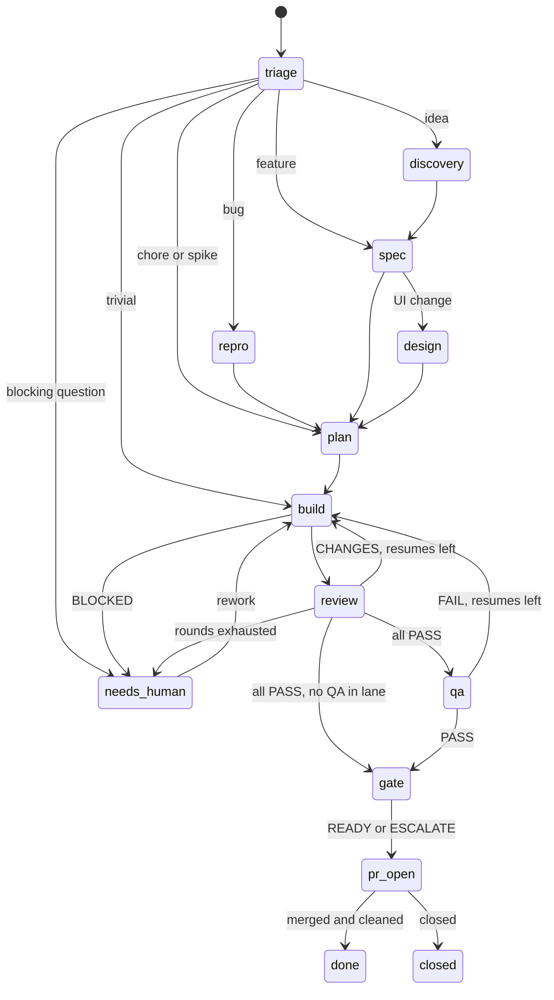

# 03 — Reading a job

**Status:** Active
**Last updated:** 2026-10-19

A job is one request moving through the pipeline. Everything it produces is in
two places:

- **The job folder:** `<product>/.factory/jobs/<job-id>/`. It holds the
  working notes of every agent. It is gitignored, so it stays on your machine.
- **The worktree and branch:** `<product>/../<product>-factory/<job-id>/` on
  branch `factory/<job-id>`. It holds the actual changes (code, PRD, ADR,
  docs), which become the PR.

## The job folder

```
.factory/jobs/004-tenant-org-name/
├── job.json                 state (stage, round, verdicts, branch, worktree, PR)
├── triage.md                coordinator: type, tier, surface, priority, lane, risk
├── spec.md                  product-manager: requirements + acceptance criteria
├── design.md                designer (ui jobs only)
├── plan.md                  tech-lead: files, approach, acceptance list, lenses, risk
├── build.md                 engineer: what changed + evidence per criterion
├── round-1/
│   ├── review-code.md       reviewer-code
│   ├── review-security.md   reviewer-security
│   ├── review-ux.md         reviewer-ux (ui jobs)
│   └── review-ui.md         reviewer-ui (ui jobs)
├── round-2/ …               only if round 1 had CHANGES
├── qa.md                    tester: acceptance walk with evidence
├── gate.md                  tech-lead: READY or ESCALATE, and why
├── pr.md                    the PR body
└── rework-1.md              your /factory rework note, if any
```

Bugs also have `repro.md`, ideas have `discovery.md`, releases have
`release.md`, and finished jobs may have `retro.md`.

## Verdicts: read the first line

Every artifact's first line is its verdict. You can understand a job by reading
only first lines:

```bash
cd .factory/jobs/004-tenant-org-name && head -n1 *.md round-*/*.md
```

| File | Good | Needs attention |
|---|---|---|
| `spec.md`, `design.md`, `plan.md`, `build.md`, `discovery.md`, `release.md` | `STATUS: READY` | `STATUS: BLOCKED`: the file says exactly what is missing and who can provide it |
| `repro.md` | `REPRODUCED` | `NOT REPRODUCED`: the bug may already be fixed, or the steps are incomplete |
| `review-*.md` | `VERDICT: PASS` | `VERDICT: CHANGES`: findings with `path:line` and the fix wanted |
| `qa.md` | `VERDICT: PASS` | `VERDICT: FAIL`: the failed criteria with evidence |
| `gate.md` | `READY` | `ESCALATE`: see "For the human" |

## Stages

`job.json` → `stage` moves through the lane:



The full state machine and its guards are in
[architecture/JOB_LIFECYCLE.md](../architecture/JOB_LIFECYCLE.md).

## The dashboard

```bash
pf dashboard     # then open http://127.0.0.1:8000/dashboard.html
```

Jobs appear as cards in six columns: Product, Plan, Build, Review & QA, Gate/PR,
Human & done. Review chips are coloured by verdict (green for PASS, orange for
CHANGES, grey for pending, faded for skipped). A red-edged card needs you.
Click a card to read every file in its folder. The page refreshes every 3
seconds.

## Answering `needs-human`

The coordinator tells you which file blocked the job. Read it, then:

| Blocked by | Usually means | You do |
|---|---|---|
| `triage.md` question | The request is ambiguous on product intent | Reply in the same session with the answer, or start again with a clearer request |
| `spec.md` / `plan.md` BLOCKED | Missing decision, contradicting PRD, missing design source | Decide, update the product doc if needed, then re-run the job or `/factory rework` |
| `design.md` BLOCKED | The Figma frame or design source is missing | Add the frame, or set `design.require_source: false` |
| `build.md` BLOCKED | The environment fails, the plan is impossible, or a human decision is needed | Fix the environment (see troubleshooting), then `/factory rework <job> "<what changed>"` |
| `repro.md` NOT REPRODUCED | Steps incomplete, or already fixed | Add steps and re-run, or close the request |
| `gate.md` ESCALATE (rounds exhausted) | Reviewers and engineer disagreed twice | Read the last round's findings. Decide, then `/factory rework` with your ruling |
| `gate.md` ESCALATE (risk) | The change touches auth, payments, migrations, CI, dependencies, or a `[DECISION]` assumption | Review the draft PR carefully. Merge it, ask for rework, or close it |

## Reviewing the PR

`pr.md` becomes the PR body. It contains a summary, links to the spec, PRD or
ADR in the branch, each acceptance criterion with evidence, the review verdicts
per round, and the risk. Check at least:

1. The acceptance list matches what you asked for.
2. The evidence is real: commands with output, or what a page showed. "It
   compiles" is not evidence.
3. The docs changed along with the behaviour.
4. The risk section names anything you would want to look at yourself.

Merge it yourself on GitHub or GitLab. Then run `/factory clean`.

<!-- documentation-routing:start -->
## Documentation routing

- Parent: [Operator guide](README.md)
- Documentation home: [Product Factory documentation](../README.md)
- Agent guide: [AGENTS.md](../../AGENTS.md)
<!-- documentation-routing:end -->
