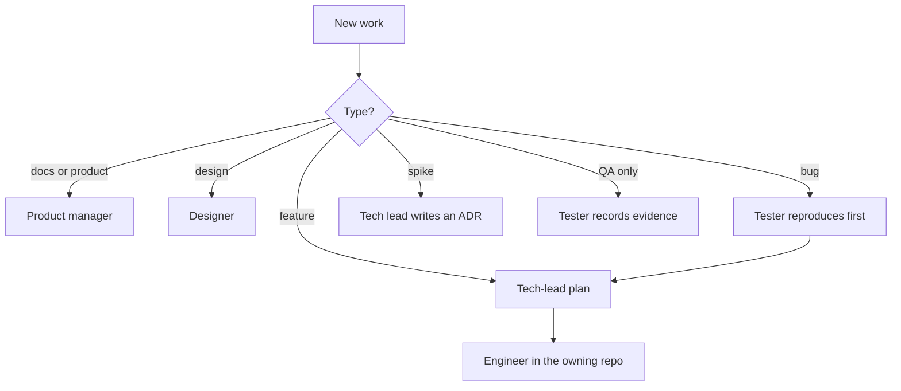
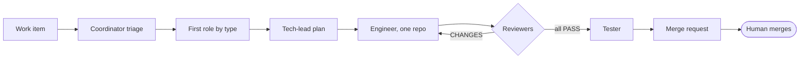

# Agentic factory workflow

**Status:** Active
**Last updated:** 2026-10-20

How a team of AI agents takes work from an idea to a reviewed merge request that a
human merges. The Product Factory implements this; an earlier agent harness
proved most of it in daily use.

## Roles

| Role | Does | Never |
|---|---|---|
| Coordinator | Classifies, triages (understand, dedupe, size, prioritise), splits, delegates, keeps the board | Implements the whole change itself |
| Product manager | PRDs, packets, acceptance intent | Runtime code |
| Designer | Screens, tokens, copy; paired locale and theme variants | Invents behaviour not in a PRD; works without the design source |
| Tech lead | A bounded plan (files, packet, acceptance) and the review gate | Merges |
| Engineer | Executes the plan in one repo, following that repo's conventions | Chooses its own scope |
| Reviewers | Independent code, security, UX and UI review before and after each change round | Fixes while reviewing |
| Tester | Reproduces bugs, walks flows, records acceptance evidence | "Fixes it while reproducing" |
| Release manager | Release notes from the development log, release proposals | Tags, deploys or publishes |

Run the code reviewer on a different model family than the engineer where
possible; it catches different mistakes.

## Classification

- **Tier** (how wide): trivial (typo, focused bug), standard (one repo), or
  cross-cutting (product, API, schema, auth, tenant). Prefer the lower tier; the
  tier decides what docs are read.
- **Type** (what kind) decides the first role: docs or product → product manager;
  design → designer; bug → tester reproduces first; feature → tech lead plan; spike
  → tech lead ADR; QA → tester.
- **Repo** decides where the work lands; one change lands in one repo.

## The line

Work starts from chat or from a labelled issue picked up by a scheduled intake.
The same rules apply to both doors.

## Artifacts, not conversation

Each step writes a file into the job folder whose first line is a verdict
(`APPROVED`, `CHANGES`, `PASS`, `FAIL`, `ESCALATE`). The next step reads files, not
chat history. Each job runs in its own git worktree on its own branch, outside the
main checkout. Rework loops are bounded (for example two resumes), then the job
escalates as a draft merge request.

## Humans own the irreversible

Agents open merge requests and stop. Merging, tagging, releasing, deploying,
publishing and changing protection are human actions, enforced mechanically (a
command guard hook and branch protection), not only by instruction.

Where it is defined for this factory: the constitution, the coordinator skill and
the role agents in the factory repository.

<!-- documentation-routing:start -->
## Documentation routing

- Parent: [Agentic workflows](README.md)
- Documentation home: [Product Factory documentation](../../README.md)
- Agent guide: [AGENTS.md](../../../AGENTS.md)
<!-- documentation-routing:end -->
