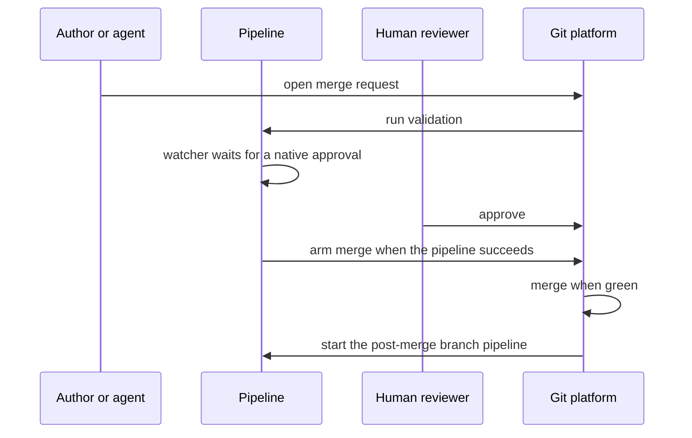

# Merge requests and approval

**Status:** Active
**Last updated:** 2026-10-20

## Approval-gated automatic merge

A pattern that keeps humans in charge without a manual merge click:

1. The merge-request pipeline validates (conventions, static gates, builds).
2. A watcher job waits for one **native platform approval** from a human (bots and
   the project token do not count).
3. On approval it arms merge-when-pipeline-succeeds and exits; the platform merges
   when the full pipeline is green, and the post-merge branch pipeline starts.

An older variant uses a manual "Play to merge" job; prefer native approval, which
is auditable and cannot be triggered by a bot.

Rules: pipelines must succeed before merge; skip variables are ignored; agents open
merge requests and stop, and never approve, merge, tag or deploy.

## Tokens

Job tokens on some self-hosted GitLab versions cannot read merge requests. Use a
dedicated release-bot token with the minimum scope for notes and the approval
watcher, stored as a masked variable, and never write it into a URL or a message
body.

## Notes and notifications

- Generate merge and release notes from the merge request and commits: branches,
  title, description, commit titles, approver, merger, time and link.
- Post them to a team chat channel (for example one topic per repo) as the last
  job, so a post means every earlier job succeeded.
- Never post artifacts, file trees or hashes of build output to chat; a separate
  restricted channel is for secrets handover only, if at all.
- Release tags create a platform release with notes and download links.

<!-- documentation-routing:start -->
## Documentation routing

- Parent: [CI/CD](README.md)
- Documentation home: [Product Factory documentation](../../README.md)
- Agent guide: [AGENTS.md](../../../AGENTS.md)
<!-- documentation-routing:end -->
