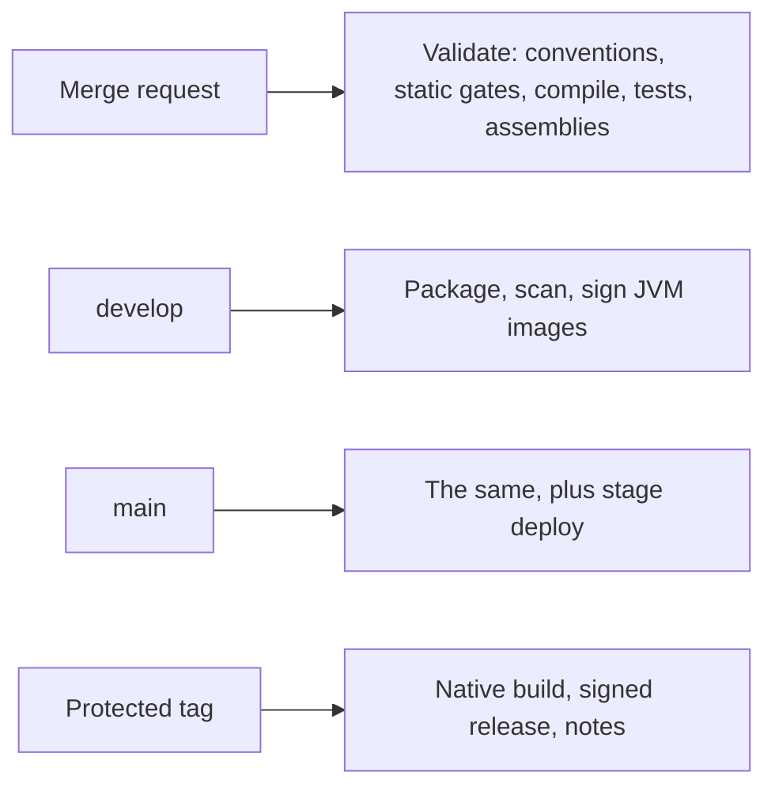

# Pipeline design

**Status:** Active
**Last updated:** 2026-10-20

Lessons from running several product repos (Spring services, a KMP Android app,
static web apps, a product-docs repo) on self-hosted GitLab.

## Shape

- The root CI file only includes a `.ci/` folder of focused files (`workflow`,
  `validate`, `package`, `image`, `release`, `distribute`, `approve`).
- Every job selects its runner through one variable (`default.tags:
  ["$RUNNER_TAG"]`), so a group-level variable moves the whole estate to another
  runner without code changes, and deleting it rolls back.
- Stages run in a fixed order, notifications last.

## What runs where

| Trigger | Runs | Does not run |
|---|---|---|
| Merge request | Conventions, static gates, compile, tests per policy, docs checks, debug and release assemblies for apps | Image builds, signing, deploys |
| `develop` | Package, scan and sign artifacts; notes | Re-running MR validation; deploys |
| `main` | The above, plus deploy to stage when configured | Production-only steps |
| Protected tag | Release build, signed artifacts, platform release, notes | Stage deploys |

Do not repeat on the branch pipeline what the merge request already proved.

## Expensive builds only where consumed

Native compilation (GraalVM `native-image`) needs large memory (12–16 GB heap per
service) and hours on shared runners. Run it **only on release tags**, because only
the release consumes native binaries. `develop` and `main` build JVM images
(labelled, for example, `image-kind=jvm-stage`) for stage. A tag always supersedes
them. Record the trade-off (bigger attack surface between tags) in an ADR.

When two repos share one native build slot, serialise them with a compare-and-swap
lock (an object store with conditional `If-Match`/`If-None-Match` writes); a
registry or a write-once binary repo cannot provide that. Compile one service at a
time, size the heap from the job's cgroup, and re-acquire the lock inside the job so
a retry cannot run unlocked.

## Large artifacts

Platform job-artifact limits reject big files (HTTP 413). Hand large binaries and
JARs between jobs through a raw binary repository keyed by commit SHA
(`{product}/ci-native/$CI_COMMIT_SHA/`), and keep only a small stamp as the job
artifact. Images go to a registry directly (`docker push`), not as tarballs.

## Cross-project dependencies

One repo's pipeline publishes a tiny manifest (variable → image reference) to the
binary repository; the consuming repo fetches it at deploy time. A missing sibling
image fails only the deploy job, never the merge gate.

## Android apps

- Merge requests into `develop` assemble beta debug and release; into `main`,
  production debug and release.
- `main` performs the one signed production build (APK and AAB) and publishes it.
- Tags build release artifacts for the platform release and distribution.
- Signing keys and production base URLs are **protected** variables; the build
  reads them from CI secrets, never from git.

## Reliability

- Retry transient runner and registry failures (`runner_system_failure`,
  `stuck_or_timeout_failure`) a bounded number of times.
- Prefetch vulnerability databases into a cache before parallel scans so concurrent
  scans do not fail on partial downloads.
- Use small Alpine images for script-only jobs and the build image only where the
  toolchain is needed; some build images lack `git` or have custom entrypoints
  (clear them with `entrypoint: [""]`).
- Write placeholder files when an older platform version rejects optional
  artifacts.

<!-- documentation-routing:start -->
## Documentation routing

- Parent: [CI/CD](README.md)
- Documentation home: [Product Factory documentation](../../README.md)
- Agent guide: [AGENTS.md](../../../AGENTS.md)
<!-- documentation-routing:end -->
