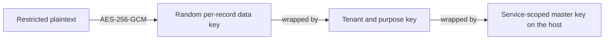

# Cryptography by layer

**Status:** Active
**Last updated:** 2026-10-20

Where each cryptographic control belongs across presentation, domain, data,
infrastructure and operations. The normative algorithm and key-custody policy
lives in `docs/security/`; this chapter explains placement and usage.

Say precisely what the product protects. Server-side envelope encryption lets
authorized services read restricted data to perform product behaviour; it is not
end-to-end encryption, and no feature may claim otherwise.

## 1. Protection map

| Boundary | Mechanism | Owning layer |
|---|---|---|
| Public HTTP and WebSocket | TLS 1.3 (HTTPS/WSS) | Edge and deployment |
| Service-to-service HTTP | mTLS, service identity, audience and path scope | `core/security`, deployment PKI |
| Database, broker, cache, object storage links | Authenticated TLS, named identities, ACLs | Configuration and deployment |
| Restricted persisted fields | Envelope encryption: per-record AES-256-GCM data key, contextual AAD | Feature `data` mappers plus `core/security` |
| Password verification | Argon2id encoded hash | Domain use case through a `PasswordHasher` port |
| Opaque high-entropy tokens | SHA-256 digest; HMAC-SHA-256 when the storage key is observable | Approved security ports |
| Exact lookup over restricted values | Versioned HMAC-SHA-256 blind index | Feature port plus adapter |
| Access tokens and signed audit material | Asymmetric signatures with service-scoped keys | `core/security` |
| Backups | Encryption to an offline recipient key after compression | Operations tooling |
| Logs, traces, metrics, errors, events | Minimisation and redaction | Every layer |

Encryption never replaces authorization, row-level security, retention, redaction
or least privilege. Apply them together.

## 2. Classify before implementing

| Classification | Examples | Treatment |
|---|---|---|
| Secret | Password, refresh token, OAuth credential, private key | Hash when verification-only; otherwise envelope; never log |
| Restricted content | Private message, calendar detail | Envelope; no plaintext search |
| Personal data | Email, display name, biography | Envelope; blind index only for an approved exact lookup |
| Sensitive operational | Sync cursor, push endpoint keys | Envelope or purpose-specific HMAC |
| Tenant and routing metadata | UUID, status, kind, timestamp, relationship | Plaintext where needed for RLS, integrity, routing, indexing |
| Public | Hostname, public JWK | Plaintext with integrity controls |

If a field needs equality lookup, sorting, range queries or uniqueness, document
it. Never switch to deterministic encryption.

## 3. Responsibilities by layer

- **Presentation** translates DTOs only. No ciphers, raw credential hashing, key
  unwrapping or algorithm choice in controllers. Envelope handling for protected
  requests runs in a shared security filter before controllers.
- **Domain** expresses plaintext business concepts for the shortest lifetime and
  depends on narrow capabilities such as `PasswordHasher`. Use `CharArray` or
  `ByteArray` for credentials and clear them in `finally`.
- **Data** mappers and adapters own reversible field protection. Entities carry the
  complete envelope; domain repositories never expose ciphertext metadata.
- **DI** wires approved interfaces from `core/security`. Features never instantiate
  crypto providers. Development-only providers are guarded by an explicit profile.
- **Operations** own certificates, trust roots, key files, secret mounts, storage
  encryption and encrypted backups. Services fail startup, or reject protected work,
  when required material is missing. No blank or default production secrets, no
  plaintext fallback.

## 4. Envelope encryption for restricted fields

Every restricted field stores a versioned envelope:

- AES-256-GCM payload encryption with a random 256-bit data key per record and field;
- a random 96-bit nonce and a 128-bit tag;
- canonical contextual AAD: service, purpose, tenant, aggregate type and ID, field,
  schema version (so an envelope cannot be copied to another tenant, record or field);
- the wrapped data key with provider, key name and key version;
- explicit envelope and context versions.

```kotlin
internal fun Message.toEntity(protector: SensitiveDataProtector): MessageEntity {
    val plaintext = content.encodeToByteArray()
    val envelope = try {
        protector.protect(plaintext, messageContext(this))
    } finally {
        plaintext.fill(0)
    }
    return MessageEntity(
        id = id,
        tenantId = tenantId,
        contentKeyVersion = envelope.keyReference.version,
        contentPayloadNonce = envelope.payloadNonce,
        contentWrappedKey = envelope.wrappedDataKey,
        contentCiphertext = envelope.ciphertext,
        // … every envelope column
    )
}
```

Reveal with exactly the same context. Never catch an authentication or
unknown-version failure and return a blank value: corruption, wrong context,
retired keys and unavailable key operations fail closed.

Use explicit columns with `CHECK` constraints in Flyway (nonce length, positive key
version, minimum ciphertext length). For an optional envelope, require either every
envelope column to be null or every required column to be valid. Do not use a
transparent JPA `AttributeConverter`, `pgcrypto`, Jasypt or one unvalidated blob.

## 5. Keys: hierarchy, custody, rotation



- Keys are generated on the target host with the OS CSPRNG. Each service has its
  own master key and signing material, mounted only into that service.
- Rotation rewraps keys without decrypting payloads. Keep only the active and the
  immediately previous version during overlap. Never accept an unknown provider,
  suite or version silently.

## 6. Passwords and verification-only secrets

Passwords are hashed, never encrypted. Use the injected `PasswordHasher`
(Argon2id; a floor such as 64 MiB memory, 3 iterations, 16-byte salt, 32-byte
output; upgrade on successful login when parameters change).

High-entropy opaque tokens (refresh, invitation, reset, session, challenge) are
generated with `SecureRandom`, shown once, and stored as SHA-256 digests.
Low-entropy secrets never use plain SHA-256.

## 7. Blind indexes

Only for an approved exact-match query. Normalise per field before indexing;
separate keys by service, field, purpose and version; overlap only the active and
previous versions; keep the plaintext in an envelope too. Blind indexes never
enable `LIKE`, range, prefix or full-text search.

## 8. Tokens, signatures, integrity

Access tokens are short-lived signed tokens, not encrypted containers. Proof of
possession (DPoP) binds access to a device key where the client supports it.
Public keys need trusted delivery and version validation. Never describe signing,
hashing, encoding or redaction as encryption.

## 9. Transport

Public traffic uses TLS 1.3 at the edge. Every service port uses mTLS internally.
Infrastructure clients verify certificates (`sslmode=verify-full`, broker TLS 1.3).
Development uses a generated CA that clients trust explicitly; certificate
verification is never disabled.

## 10. What stays plaintext

Tenant, member, aggregate and resource IDs; timestamps, status, kind, role,
ordering and relationships; approved names and slugs; public keys. Plaintext does
not mean public: authorization, RLS, redaction and encrypted transport still apply.

## 11. Prohibited patterns

- Raw JCA/JCE, Bouncy Castle or JOSE code outside `core/security`.
- Jasypt, `pgcrypto`, transparent JPA encryption converters, deterministic
  encryption, shared static production keys.
- A constant nonce, a reused key and nonce pair, homemade serialization,
  unversioned ciphertext.
- Hashing passwords with SHA-256 or recoverable password encryption.
- Logging secrets before encryption or plaintext after reveal.
- Catching decrypt failures and returning null, empty content or plaintext.
- Disabling TLS verification anywhere.

## 12. Adding a protected field

1. Classify the value and document required queries.
2. Confirm plaintext routing metadata cannot satisfy the query safely.
3. Reuse `SensitiveDataProtector`; add no cipher to the feature.
4. Define a stable protection context with tenant and record binding.
5. Add every envelope column and its Flyway constraints.
6. Protect and reveal explicitly in the data mapper.
7. Zero plaintext and key byte arrays in `finally`.
8. Add a blind index only for an approved exact match.
9. Keep the content out of errors, logs, events, audit and push payloads.
10. Document schema, API, event and threat-model deltas.
11. Run the gates and record acceptance evidence: authorized round trip, failure
    after moving ciphertext to another context, failure on unknown version or
    corrupted tag, redacted logs.

<!-- documentation-routing:start -->
## Documentation routing

- Parent: [Spring Boot services](README.md)
- Documentation home: [Product Factory documentation](../../../../README.md)
- Agent guide: [AGENTS.md](../../../../../AGENTS.md)
<!-- documentation-routing:end -->
