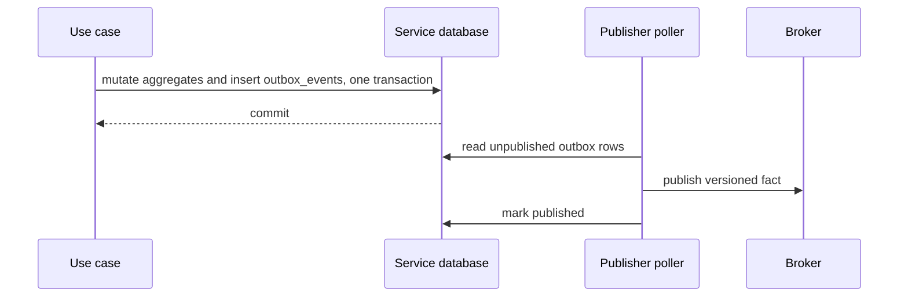
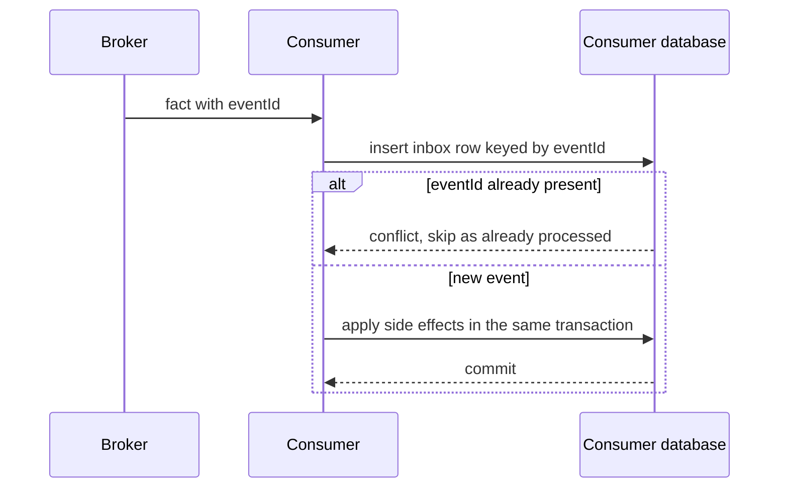

# Events: outbox and inbox

**Status:** Active
**Last updated:** 2026-10-20

Cross-service **facts** travel on the broker through a transactional outbox and
inbox. Current **authorization decisions** never do: they use authenticated
internal HTTP and fail closed ([06](security.md)).

## Rules

1. Commit domain state and the outbox row in the same database transaction.
2. Event names are past tense, versioned, tenant-scoped and schema-published.
3. Consumers persist an inbox record for the event ID before any side effect.
4. Reprocessing is idempotent and safe.
5. No shared messaging database; each durable service owns its tables.
6. Transactions never span services.
7. Events carry identifiers and minimal facts, never restricted payloads.

## Producer pattern

## Consumer pattern

If the inbox insert conflicts, the fact was already processed: skip it.

## Event envelope

| Field | Meaning |
|---|---|
| `id` | Unique event UUID (the inbox key) |
| `type` | Past-tense name, for example `message.created` |
| `version` | Schema version of the payload |
| `tenantId` | Owning tenant |
| `occurredAt` | UTC ISO-8601 |
| `payload` | Typed, minimal facts |

## Contracts

| Artifact | Location |
|---|---|
| Narrative catalog | `docs/api/EVENT_CATALOG.md` |
| AsyncAPI | `docs/api/asyncapi/` |
| Envelope schema | `docs/api/schemas/event-envelope.schema.json` |

A new or changed event updates all three in the same change, plus every consumer
named in the catalog.

<!-- documentation-routing:start -->
## Documentation routing

- Parent: [Spring Boot services](README.md)
- Documentation home: [Product Factory documentation](../../../../README.md)
- Agent guide: [AGENTS.md](../../../../../AGENTS.md)
<!-- documentation-routing:end -->
