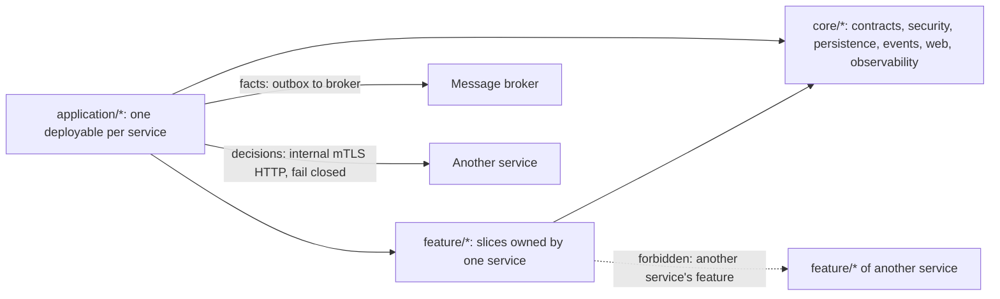

# Service architecture

**Status:** Active
**Last updated:** 2026-10-20

the repository is a set of independently deployable Spring Boot services. This chapter
covers topology and ownership. Runtime detail lives in
../architecture/OVERVIEW.md; invariants live in
[00-engineering-principles.md](principles.md).

## Topology

- **Facts** (something happened) travel on the message broker through the
  transactional outbox and inbox ([05](events-outbox-inbox.md)).
- **Current decisions** (may this actor do this now?) use authenticated internal
  HTTP and fail closed ([06](security.md)).

## Service ownership

Each durable service owns its domain database, its Flyway history and its
credential. Cross-service database reads and foreign keys are forbidden. A
service that keeps only ephemeral state (for example a realtime gateway) owns no
durable domain database.

Keep this table true. It is the first thing a reviewer checks.

| Service | Owns (data and behaviour) | Database |
|---|---|---|
| `<service>` | `<aggregates and use cases>` | `<db name, or none>` |

## Feature-to-service compile rule

A feature under `feature/*` compiles into exactly one owning `application/*`
service. Shared infrastructure belongs in `core/*` only when it is stable and
feature-agnostic. When two services need the same behaviour, one owns it and the
other asks over HTTP or reacts to its facts.

## Public contract prefixes

| Prefix | Audience | Owner |
|---|---|---|
| `/api/v1` | Public REST clients | `<service>` |
| `/ws/v1` | Public WebSocket | `<service>` |
| `/admin/v1` | Administration BFF | `<service>` |

## Adding a service

1. Write an ADR: why a new deployable, what it owns, what it never owns.
2. Add `application/<service>` with its own Flyway location and credential.
3. Move or create the owned features; update the ownership table above.
4. Add OpenAPI/AsyncAPI documents and the internal routes it exposes.
5. Update deployment, CI image jobs and the architecture overview.

<!-- documentation-routing:start -->
## Documentation routing

- Parent: [Spring Boot services](README.md)
- Documentation home: [Product Factory documentation](../../../../README.md)
- Agent guide: [AGENTS.md](../../../../../AGENTS.md)
<!-- documentation-routing:end -->
