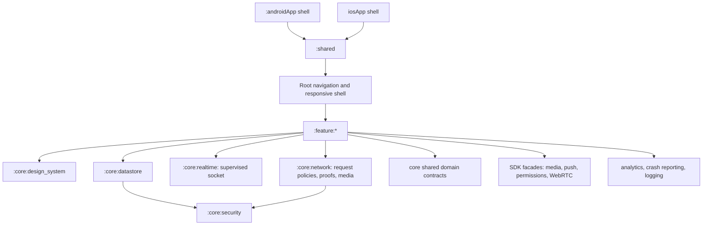
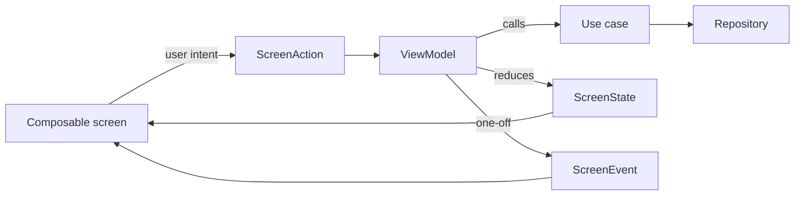

# Client app architecture

**Status:** Active
**Last updated:** 2026-10-20

A Kotlin Multiplatform Compose application: thin platform shells, one shared app
shell, core infrastructure modules, and feature modules that own their MVI state,
navigation keys, repositories, use cases and platform abstractions.

## Layers

| Layer | Responsibility |
|---|---|
| App shells | `Application` / `MainActivity` (or the Xcode entry), OS services, `ActivityResult` binders for core facades |
| `:shared` | DI initialisation, app root, route parsing, platform link and back adapters, the responsive shell |
| `:core:design_system` | Compose components, tokens, typography, navigation primitives, localized UI text |
| Core infrastructure | The network facade with explicit request policies, device identity, media transfer, encrypted datastore, supervised realtime, push, cache, resources |
| Core shared domain | Contracts shared by several features, so features never import each other |
| Core SDK facades | WebRTC, voice, media pickers, OAuth, push, permissions: interfaces plus platform implementations, consumed through DI |
| Core observability | Analytics, crash reporting and logging facades (consent-gated, redacting) |
| Feature modules | Vertical product slices |

Rules: features never import other features; cross-feature needs go through a core
contract or the shell. Vendor SDKs appear only behind core facades.

Inside a feature, each screen follows MVI ([presentation](presentation-mvi.md)):

## Data policy: online-first

The backend owns durable data (messages, files, calls, membership, policy). The
client persists only:
- versioned, encrypted authentication and settings state;
- known-organization or workspace metadata needed to restore a session;
- explicitly approved, bounded feature caches.

REST is authoritative. Realtime frames and push wakes are invalidation hints that
trigger reconciliation, never a second source of truth. Identity-bound caches are
cleared when the identity, host or provider lifecycle changes. Offline editing and
durable local history are out of scope unless a product decision says otherwise
(record it as an ADR).

## Request policy

The network facade makes the authentication policy of each request explicit, for
example: none, an auth envelope for sensitive auth calls, a proof-of-possession
token for normal API calls, a one-use action grant for step-up operations, and
external media where no product credentials may be attached
([security-and-cryptography.md](security-and-cryptography.md)).

## Verifying the architecture

`settings.gradle.kts`, the convention plugins in `build-logic/` and the active
source sets are the truth. A module map in the repo's architecture docs lists each
module and its owner; update it in the change that adds or removes a module.

<!-- documentation-routing:start -->
## Documentation routing

- Parent: [Kotlin Multiplatform client](README.md)
- Documentation home: [Product Factory documentation](../../../README.md)
- Agent guide: [AGENTS.md](../../../../AGENTS.md)
<!-- documentation-routing:end -->
