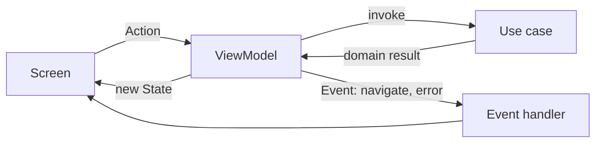

# Presentation: MVI

**Status:** Active
**Last updated:** 2026-10-20

## Page layout

```text
presentation/component/page/<page>/
  screen/<Page>Screen.kt
  screen/<Page>ScreenViewModel.kt
  state/<Page>ScreenState.kt
  action/<Page>ScreenAction.kt
  action/<Page>ScreenActionHandler.kt
  event/<Page>ScreenEvent.kt
  event/<Page>ScreenEventHandler.kt
```

## Contract

| Type | Role |
|---|---|
| `State` | An immutable data class; the single source of what the screen shows |
| `Action` | A sealed interface of user intents |
| `Event` | A sealed interface of one-off effects (navigation, errors, toasts) on a `SharedFlow` |
| `ViewModel` | Reduces actions into state, calls use cases, emits events; never holds DTOs |
| `Screen` | Collects state with lifecycle, renders content, forwards actions |

```kotlin
internal data class LoginScreenState(
    val email: String = "",
    val password: String = "",
    val isLoading: Boolean = false,
)

internal sealed interface LoginScreenAction {
    data class UpdateEmail(val email: String) : LoginScreenAction
    data class UpdatePassword(val password: String) : LoginScreenAction
    data object Login : LoginScreenAction
}

fun onScreenAction(action: LoginScreenAction) {
    when (action) {
        is LoginScreenAction.UpdateEmail -> _screenState.update { it.copy(email = action.email) }
        is LoginScreenAction.UpdatePassword -> _screenState.update { it.copy(password = action.password) }
        LoginScreenAction.Login -> signIn()
    }
}
```



## Navigation

- Each feature owns typed navigation keys under `presentation/navigation/` and
  mutates its own stack.
- Cross-feature hops go through shell events, never into another feature's
  navigation host.
- Deep links are validated (IDs, capability state) before navigation.

## States every screen designs

Loading, empty, content, error with retry, unauthorized, offline or stale, and
destructive confirmation. Strings come from localization resources, and layouts
hold up at compact and expanded widths and large font sizes.

<!-- documentation-routing:start -->
## Documentation routing

- Parent: [Kotlin Multiplatform client](README.md)
- Documentation home: [Product Factory documentation](../../../README.md)
- Agent guide: [AGENTS.md](../../../../AGENTS.md)
<!-- documentation-routing:end -->
