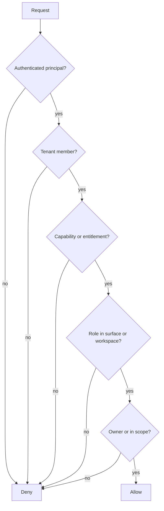

# Transport and identity

**Status:** Active
**Last updated:** 2026-10-20

## Transport

| Link | Requirement |
|---|---|
| Public API, web, WebSocket, media | TLS 1.3 (HTTPS/WSS) at the edge; no cleartext client port, even in development |
| Service to service | TLS 1.3 mTLS; service identity in the certificate SAN; exact audience and allow-listed method/path scope |
| Database | TLS with `verify-full` |
| Broker | Mutual TLS and per-service ACLs, fail closed |
| Cache | TLS and named ACL users |
| Object storage | HTTPS, private buckets, provider encryption with a pinned key, versioning |

Development uses a generated CA that clients and browsers trust explicitly.
Certificate and hostname verification are never disabled, in any build.

## Identity and authorization

- Every resource operation checks, in order: an authenticated principal, tenant
  membership, capability or entitlement, role in the surface or workspace, and
  ownership.
- Actor and tenant context between services is added only by internal client
  adapters, carried over the authenticated channel, validated before controller
  work, and rejected at the edge. Missing, duplicated, malformed, expired or
  mismatched context fails closed.
- **Facts vs decisions:** past facts travel on the broker; current allow/deny
  decisions are synchronous internal calls that fail closed.

## Credentials

- Passwords: length limits (for example 12–128), no composition rules, compromised
  password screening, Argon2id with upgrade on login.
- Access tokens: short-lived, signed, audience-bound; proof-of-possession (DPoP)
  binds them to a device key, with server nonces and one-time proof IDs.
- Refresh tokens: opaque, hashed, device-bound, rotated; replay revokes the family.
- Browser sessions: opaque `__Host-` cookies (`Secure`, `HttpOnly`,
  `SameSite=Strict`) and rotating CSRF tokens; no JWTs in browser storage.
- One-use capabilities (invitations, resets, setup licenses, action grants): high
  entropy, stored as digests, shown once, bound to their purpose and expiry.
- Self-hosted servers without a public certificate: an explicit, interactive
  trust-on-first-use pin of the exact certificate fingerprint, re-prompting with a
  warning when it changes. Never a silent fallback.

<!-- documentation-routing:start -->
## Documentation routing

- Parent: [Security](README.md)
- Documentation home: [Product Factory documentation](../../README.md)
- Agent guide: [AGENTS.md](../../../AGENTS.md)
<!-- documentation-routing:end -->
