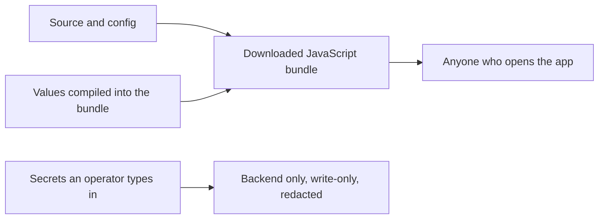

# Web security

**Status:** Active
**Last updated:** 2026-10-20

State what the product protects and what it does not. TLS protects transport;
browser code is downloadable and never secret.

## Threat model and controls

| Risk | Control |
|---|---|
| Credential theft | Same-origin HTTPS submission; never stored in local or session storage, URLs, logs or analytics; cleared from state after exchange |
| XSS and injected dependencies | Strict CSP without `unsafe-inline`/`unsafe-eval`, no third-party scripts, framework escaping, no `dangerouslySetInnerHTML`, SRI, an artifact hash manifest |
| CSRF | Server-issued token held in memory and sent as a header on mutations; `Secure`, `HttpOnly`, `SameSite=Strict` cookies owned by the backend |
| Clickjacking and capabilities | `frame-ancestors 'none'`, COOP, a restrictive Permissions-Policy |
| Data leakage | `no-referrer`, no source maps in production, no public secrets, redacted errors, no-index metadata |
| Supply-chain drift | Exact direct versions, frozen lockfile, install scripts disabled in container builds, signed images |

## Keys and environment variables

There are no front-end secret keys. Anything compiled into the bundle (for example
`NEXT_PUBLIC_*`) is public. Never put private keys, API secrets, signing keys,
database credentials, OAuth client secrets or service tokens in code, public
assets, framework config, build args, environment files, browser storage or
telemetry. Secrets an operator types in (SMTP, OAuth) go to the backend, are
write-only, and come back redacted.

## Obfuscation and signing

Obfuscation is not a security boundary. Use minification, hashed chunks, disabled
source maps, SRI and an integrity manifest. Image signing proves provenance and
integrity; it does not make browser code confidential. Signing keys live only in
the release system (prefer keyless OIDC).

## Review checklist

- Search for public env prefixes, `.env`, tokens, storage APIs,
  `dangerouslySetInnerHTML` and external URLs.
- Inspect real response headers through the edge, not only configuration.
- Verify the production CSP has no `unsafe-inline` or `unsafe-eval`.
- Run dependency and container vulnerability scans in release CI.

<!-- documentation-routing:start -->
## Documentation routing

- Parent: [Web apps](README.md)
- Documentation home: [Product Factory documentation](../../../README.md)
- Agent guide: [AGENTS.md](../../../../AGENTS.md)
<!-- documentation-routing:end -->
